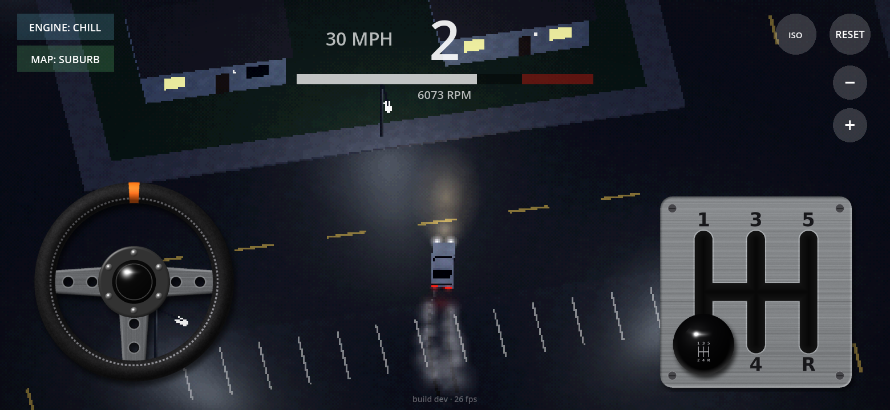

# Stick Drift

*Night drifting with a real stick.*

A chill, semi top-down, pixelated low-poly drift game. A quiet night-time suburb (or Tokyo streets), white LED street lights, an S13-style coupe, an on-screen steering wheel and a real H-pattern stick shift. The gas is always on, so shifting *is* the game: forget to shift and you'll blow the engine, downshift too hard and you'll blow it faster.

Built in Godot 4.7.



## Play it

**On your iPhone (or any phone):** open [stonecoldos.github.io/stick-drift](https://stonecoldos.github.io/stick-drift/) in Safari and turn the phone sideways. Every push to `main` rebuilds it (give it a couple of minutes, then refresh).

**Full screen on iPhone:** Safari won't let a web page hide its address bar, so add it to your home screen once: in Safari tap **Share > Add to Home Screen**, then launch it from the icon. It opens full screen with no address bar.

**On the Thor:** every push also builds an APK. Open the [latest build](https://github.com/StoneColdOS/stick-drift/releases/tag/latest-build), download `stick-drift.apk` and install it over the old one.

**On your Mac:** install [Godot 4.7](https://godotengine.org/download), click **Import**, pick `project.godot` in this folder, then press **F5**. You can drag the on-screen controls with the mouse.

## Controls

```
1   3   5
|   |   |
+---N---+
|   |   |
2   4   R
```

| | Touch | Keyboard | Gamepad (Thor) |
|---|---|---|---|
| Steer | Twist the wheel (bottom-left), two full turns each way like a real car. The orange arc shows how far you're turned. Let go and it spins back to center | A / D or arrows | Left stick |
| Shift | Drag the knob through the H gate (bottom-right) | 1-5, N or 0, R | R1 up / L1 down |
| Kick the rear out | Flick the wheel quickly, or downshift while turning (no e-brake) | Space (or tap A/D) | B |
| Camera | ISO / 3D button (top-right): flat isometric or perspective, both behind the car | V | Select |
| Zoom | Automatic: close when slow, pulls out with speed and drifting. Pinch or − / + sets how close it sits when slow | - / = or mouse wheel | Y / X |
| Reset | RESET (top-right) | Enter | Start |
| Map | MAP: SUBURB / TOKYO (top-left), reloads the game | | |

- **The gas is always on** whenever you're in gear. Short gears keep it chill around the blocks (about 22 / 40 / 58 / 79 mph in 1st to 4th); 5th is a tall overdrive for the **highway ring** around the neighbourhood, reached by a ramp from the middle street on each side.
- **Slow down** by downshifting (engine braking) or knocking it into **neutral**.
- **Drift:** there's no e-brake. Get going in 2nd and either **flick** the wheel quickly or **downshift while turning** (a clutch kick) to break the rear loose, then countersteer. Smooth steering stays planted. 2nd is the drift gear; once you're sliding you get full power to hold it.
- **Forgiving by default:** the auto gas keeps the rear tires hooked up while you're just driving, and steering tightens up with speed, so the car only slides when you kick it out. Once you're sliding you get full power to hold it, a little countersteer assist, and past about 35° the car resists spinning out.
- **Engine: CHILL (default):** a rev limiter. It bounces off redline and crackles, but never blows. Tap **ENGINE** (top-left) to switch to **RISKY**: no limiter, a health bar, and sitting on the limiter (~25s) or a money shift (way past 9800 rpm) blows it. Your pick is remembered.
- **Vibration:** gear changes buzz on the Thor and Android. On iPhone (iOS 18+) you get a haptic tick when your thumb lifts off the shifter; Safari doesn't allow anything better.

## How it's built

Everything is built in code from `scripts/main.gd`, no scene editing needed.

| File | What it does |
|---|---|
| `scripts/car.gd` | Arcade drift physics: front and rear axle grip, friction circle, flick and downshift kicks |
| `scripts/motor.gd` | Torque curve, redline, engine braking, blowing up |
| `scripts/gearbox.gd` | 5-speed ratios |
| `scripts/shifter_gate.gd` | H-pattern gate logic (knob always travels through neutral) |
| `scripts/touch_controls.gd` | Wheel, shifter, buttons |
| `tools/make_controls_art.py` | Paints the realistic wheel, knob and gate in `art/` (Python + Pillow + numpy) |
| `scripts/retro.gdshader` | Dither / colour quantization / vignette over the world |
| `scripts/hud.gd` | Gear, tach, speed, engine health, drift points |
| `scripts/tokyo.gd` | Tokyo-style district: buildings, windows, neon, vending machines, poles and wires, crosswalks, central lot |
| `scripts/building.gdshader` | Building material with an x-ray circle cut around the car so tall buildings never hide it |
| `scripts/mesh_batch.gd` | Merges thousands of boxes into a few meshes per material (keeps phones fast) |
| `scripts/neighborhood.gd` | The night suburb, street lights, and the highway ring around it |
| `scripts/car_model.gd` | Low-poly S13-style coupe, headlight/tail light glow, exhaust and backfires, skid marks, smoke |
| `scripts/chase_camera.gd` | Isometric or perspective chase camera, with zoom (both remembered) |
| `scripts/haptics.gd` | Vibration on gear changes |
| `tests/test_drive.gd` | Automated test: launches, shifts, drifts, blows the engine |

Run the test: `godot --headless --fixed-fps 120 --path . -s res://tests/test_drive.gd`. The web build only publishes if it passes.

## Tuning cheat sheet

In `scripts/car.gd`:

- More slide: lower `rear_grip`, raise `torque_multiplier`
- Easier to catch a drift: raise `countersteer_assist`, `spin_guard` or `min_rear_lateral_share`
- Harder / more raw: set `traction_control`, `countersteer_assist` and `spin_guard` to 0
- Steering sharpness at speed: `steer_grip_limit` (higher = sharper, easier to overdo)
- Kicks: `flick_threshold` (lower = easier to trigger), `kick_time`, `handbrake_grip_scale` (how loose the rear gets during a kick)

In `scripts/motor.gd`: `damage_rpm`, `sustained_damage`, `money_shift_rpm`.
Pixel size: `PIXEL_SHRINK` in `scripts/main.gd` (2 = 360 px tall world; higher = chunkier).

## Next up

- Engine and tire audio (rpm-pitched loop + screech)
- A proper low-poly coupe to replace the box car
